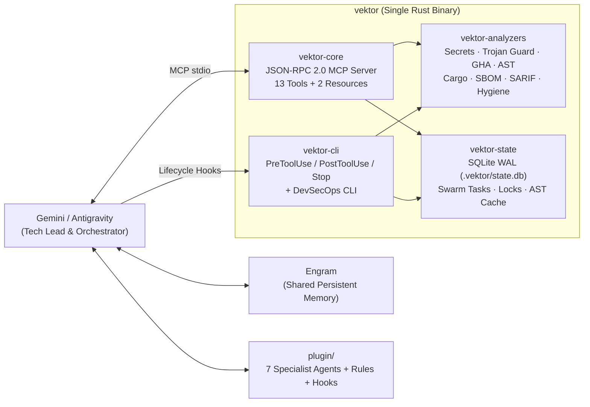

# Vektor

[](https://github.com/glastor-core/vektor/actions/workflows/ci.yml)
[](https://github.com/glastor-core/vektor/actions/workflows/security.yml)
[](https://github.com/glastor-core/vektor/actions/workflows/release.yml)
[](LICENSE)
[](Cargo.toml)
[](Cargo.toml)

**Vektor** is a 100% safe-Rust (`unsafe_code = "forbid"`) **MCP server**, **sub-millisecond Antigravity lifecycle hook engine**, **DevSecOps CLI auditor**, and **7-expert development team plugin** designed to complement **Gemini (Antigravity)** with **Engram** as the shared persistent memory backbone.

---

## Architecture



### Workspace Crates

- **`crates/vektor-core`**: Strict JSON-RPC 2.0 MCP stdio engine with protocol version negotiation (`2024-11-05`, `2025-03-26`, `2025-06-18`), `ToolAnnotations` (`readOnlyHint`, `idempotentHint`), MCP Resources, and Antigravity camelCase hook contracts.
- **`crates/vektor-analyzers`**: Pure-Rust deterministic static analyzers:
  - **Secret Scanner**: 16 provider rules (AWS, GitHub, OpenAI/Anthropic, Stripe, npm, PyPI, SendGrid, Twilio, Telegram, Hugging Face, DB URIs, JWT, GCP Service Account, etc.) + Shannon entropy + `--staged` Git pre-commit mode.
  - **Trojan Guard**: Unicode BiDi overrides (CVE-2021-42574), Unicode Tags, ANSI escapes, and zero-width invisible characters.
  - **GitHub Actions Linter & Auto-Fixer**: SHA-40 pinning, least-privilege `permissions:`, `concurrency:`, `timeout-minutes:`, `persist-credentials: false`, `pull_request_target`, script & `$GITHUB_ENV` injection, plus deterministic `--fix`.
  - **Rust AST & SemVer Diff**: Incremental `tree-sitter-rust` symbol & `unsafe` extractor + public API breaking-change diff against Git revisions.
  - **Supply Chain**: `cargo metadata` duplicate/MSRV/license auditor, CycloneDX 1.5 SBOM generator, SARIF 2.1.0 exporter, and DevSecOps repo hygiene scorer (`0–100`).
- **`crates/vektor-state`**: SQLite WAL shared state (`.vektor/state.db`) for the Swarm Task Blackboard, advisory file locks with TTL, incremental AST symbol cache, and dirty-file tracking for selective `Stop` gates.
- **`crates/vektor-cli`**: Single `vektor` binary exposing both MCP/hooks and a complete standalone DevSecOps CLI.
- **`plugin/`**: Native Antigravity Plugin bundling 7 specialized subagents (`rust-expert`, `crates-specialist`, `security-auditor`, `gh-actions-engineer`, `github-maintainer`, `astro-expert`, `markdown-docs-expert`), orchestration skill, rules, `mcp_config.json`, and `hooks.json`.

---

## Installation & Quick Start

### 1. Install the binary

```bash
# Via cargo-binstall (downloads prebuilt release binary with SLSA provenance)
cargo binstall vektor-cli

# Or build from source (MSRV 1.90)
cargo install --path crates/vektor-cli
```

### 2. Initialize workspace & plugin

```bash
# Generate starter vektor.toml and install the Antigravity plugin
vektor init --install-plugin

# Verify binary, toolchain, config, plugin, and repo hygiene
vektor doctor
```

---

## CLI Reference

Vektor works both as an Antigravity MCP/hook engine **and** as a standalone DevSecOps CLI for terminals and CI/CD pipelines:

```bash
# Full DevSecOps audit (formats: pretty | markdown | json | sarif)
vektor audit --format pretty
vektor audit --format sarif --fail-on high > vektor.sarif
vektor audit --format markdown --fail-on low      # Ideal for GitHub PR comments
vektor audit --staged --fail-on high              # Fast Git pre-commit secret check
vektor audit --fix                                # Auto-harden missing GHA permissions/concurrency

# Supply-chain & Rust analysis
vektor sbom --offline > sbom.cdx.json             # CycloneDX 1.5 SBOM
vektor deps --format markdown                     # Duplicates, MSRV conflicts, licenses
vektor api-diff --base HEAD --fail-on-breaking    # AST SemVer breaking-change gate
vektor hygiene --min-score 90 --format pretty     # 0-100 DevSecOps hygiene score

# Diagnostics & reproducible latency benchmarks
vektor doctor
vektor bench --iterations 200
```

### Configuration (`vektor.toml`)

Vektor automatically honors `.gitignore`, `.vektorignore`, and an optional workspace `vektor.toml`:

```toml
[audit]
respect_gitignore = true
ignore_paths = ["target/", "node_modules/", "dist/", ".vektor/"]
disabled_rules = []

[secrets]
entropy_threshold = 3.5

[hooks]
stop_gate = "selective" # "selective" | "full" | "off"
```

---

## MCP Tools & Resources

| MCP Tool | Purpose | Annotations |
| :--- | :--- | :--- |
| `vektor_health` | Server status and active modules | `readOnly`, `idempotent` |
| `vektor_workspace_info` | Cargo, Git, SQLite state, and GHA inventory | `readOnly`, `idempotent` |
| `vektor_team_roster` | 7-expert specialist delegation matrix | `readOnly`, `idempotent` |
| `vektor_cargo_audit_deps` | Duplicate crates, MSRV conflicts, licenses/copyleft | `readOnly`, `idempotent` |
| `vektor_scan_secrets` | 16 provider rules + Shannon entropy scanner | `readOnly`, `idempotent` |
| `vektor_lint_gha` | GitHub Actions SHA pinning, permissions, injection, timeouts | `readOnly`, `idempotent` |
| `vektor_rust_ast_query` | Incremental `tree-sitter-rust` symbol & `unsafe` index | `readOnly`, `idempotent` |
| `vektor_rust_api_diff` | AST SemVer public API breaking-change diff vs Git | `readOnly`, `idempotent` |
| `vektor_sbom_cyclonedx` | CycloneDX 1.5 JSON SBOM generator | `readOnly`, `idempotent` |
| `vektor_security_sarif` | Combined Secrets + Trojan Guard + GHA SARIF 2.1.0 | `readOnly`, `idempotent` |
| `vektor_repo_hygiene` | DevSecOps repository hygiene auditor (0–100) | `readOnly`, `idempotent` |
| `vektor_swarm_task` | Shared Swarm Task Blackboard (`list` / `upsert`) | local mutation |
| `vektor_swarm_lock` | Advisory file locks (`list` / `acquire` / `release`) with TTL | local mutation |

**MCP Resources**: `vektor://workspace/summary` and `vektor://swarm/tasks`.

---

## Verified Performance (`vektor bench`)

Measured via `vektor bench --iterations 200` (even in an unoptimized debug build; release builds are faster still):

| Operation | Average | p50 | p95 |
| :--- | ---: | ---: | ---: |
| `PreToolUse` hook (JSON → secret/Trojan scan → JSON) | `109.3 µs` | **`25.9 µs`** | **`44.1 µs`** |
| GitHub Actions lint (hardened workflow) | `66.3 µs` | **`52.6 µs`** | **`54.6 µs`** |
| Secrets + Trojan Guard scan (100-line Rust file) | `1.76 ms` | **`1.75 ms`** | **`1.81 ms`** |

---

## Contributing & Security

- See [CONTRIBUTING.md](CONTRIBUTING.md) for local verification gates and coding standards.
- See [CHANGELOG.md](CHANGELOG.md) for release history.
- See [SECURITY.md](SECURITY.md) for responsible vulnerability disclosure.
- Licensed under [MIT](LICENSE).
